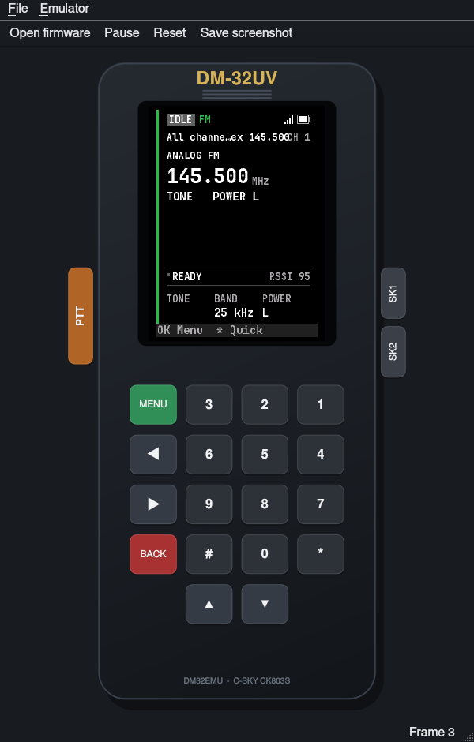
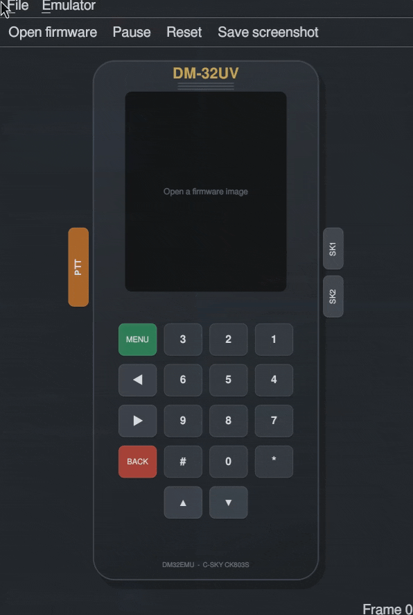

<!-- SPDX-License-Identifier: MIT -->
# DM32EMU

A small C++ emulator for the Baofeng DM-32UV radio's HR_C7000 SoC
(C-SKY CK803S core). It runs the application firmware images built by
[P32](../P32), [RadioFoundry](../RadioFoundry) and [DM32Mayhem](../DM32Mayhem)
without a radio, and is aimed at debugging the firmware rather than at
replacing a hardware-in-the-loop test.

It boots the P32 image to its home screen and menu, renders the LCD to a
PPM/PNG, prints the firmware's UART output, and supports scripted key presses,
breakpoints, memory dumps, symbols and instruction tracing.

There is also a Qt GUI (`dm32gui`) with the radio's screen and a clickable
keypad. Open a firmware image, then use the mouse or the keyboard to press
keys while the radio runs.



## Build

```sh
cmake -S . -B build -G Ninja
cmake --build build
```

This builds the command-line emulator `build/dm32emu`. If Qt6 Widgets is
available, it also builds the GUI `build/dm32gui`. No C-SKY toolchain is
needed at run time. An ELF is only used for symbols; the emulator executes the
application image itself.

## Status

Verified with the open firmware images in the sibling trees:

- **P32** (`P32/build/dm32/rfoundry_dm32.bin`): boot splash, home screen and
  the main menu. Scripted keys (`ok`, arrows, numbers, PTT, side keys) drive
  the UI.
- **RadioFoundry** (`RadioFoundry/build/dm32/rfoundry_dm32.bin`): boot splash
  and its home screen.
- **DM32Mayhem** (`DM32Mayhem/firmware/build/diag/rfoundry_dm32.bin`): boot
  splash and its boot-gate screen, which asks for the displayed code.

In all three cases crt0, clocks, cache, watchdog and the PIC are initialized,
the C-SKY FreeRTOS port starts, the tick runs, tasks switch, `board_init()`
probes the emulated SPI NOR and display, and the LCD is rendered.

The stock Baofeng firmware is a different case: it checks the ALPU chip and
needs emulator-only patches, so it is not a target of this project.

Not modelled: RF/modem data paths, AMBE audio, the FD6818 RF chip, USB, SDIO,
the ALPU authentication chip, and the codec's DSP. These are only register
stubs. The emulator is not cycle-accurate.

## Run

```sh
./build/dm32emu /path/to/rfoundry_dm32.bin \
    --symbols /path/to/rfoundry_dm32.elf \
    --frames 3 --fb home.ppm
```

A raw `.bin` is loaded at `0x0300c000`, the application base used by the
Baofeng bootloader. An `.elf` file can be passed instead; its PT_LOAD
segments are loaded by physical address and its entry point is used.

The splash is frame 1 and 2; the home screen is frame 3. A 300-million
instruction run takes about 10 seconds on a current desktop.

### GUI

```sh
./build/dm32gui
./build/dm32gui /path/to/rfoundry_dm32.bin
./build/dm32gui /path/to/rfoundry_dm32.bin --data-flash /path/to/dump.bin
```

The GUI opens with the radio screen and keypad. Use **File > Open firmware**
to load an image. The toolbar has Open, Pause, Reset and Save screenshot.


The keypad is clickable, and these keyboard keys map to the radio:

| Key | Radio key |
|---|---|
| `Enter` / `M` | Menu / OK |
| `Esc` / `Backspace` / `B` | Back |
| arrows | Left / right / up / down |
| `0`-`9`, `*`, `#` | keypad |
| `P` | PTT (hold) |
| `F1` / `F2` | SK1 / SK2 |

The emulator runs as fast as the host allows; use Pause to stop and inspect a
screen. The GUI updates the screen at about 30 Hz while frames change.

The GUI can also run headless for screenshots and tests:

```sh
QT_QPA_PLATFORM=offscreen ./build/dm32gui firmware.bin \
    --screenshot home.png --frames 3
QT_QPA_PLATFORM=offscreen ./build/dm32gui firmware.bin \
    --window-screenshot window.png --frames 3
```

`--screenshot` writes the 240x320 LCD; `--window-screenshot` writes the whole
window with the radio body and keypad. The process exits after the requested
number of full LCD frames.

### Debugging options

| Option | Meaning |
|---|---|
| `--symbols FILE` | read function names from an ELF (used by `--trace`, `--break`, faults) |
| `--break ADDR` | stop when the PC reaches `ADDR` (repeatable, hex or decimal) |
| `--dump ADDR:LEN` | dump memory when the emulator stops (repeatable) |
| `--trace` | print every instruction with its symbol and PSR |
| `--key NAME[@STEP[:N]]` | press `NAME` at instruction `STEP` for `N` instructions |
| `--key-hold N` | default key hold (20,000,000 instructions, about 120 ms) |
| `--frames N` | stop after `N` complete LCD frames |
| `--fb FILE` | write the LCD as a binary PPM on exit |
| `--fb-every N` | write `FILE.<frame>.ppm` every `N` frames |
| `--data-flash FILE` | load a real 16 MB SPI NOR dump (calibration, codeplug) |
| `--steps N` | instruction budget (default 500,000,000) |
| `--no-uart-echo` | collect UART output without printing it live |
| `--verbose` | log SPI NOR and LCD traffic and unknown MMIO |

Key names: `ok`/`green`/`menu`, `0`-`9`, `*`, `#`, `up`, `down`, `left`,
`right`, `back`/`red`, `sk1`, `sk2`, `ptt`.

Examples:

```sh
# Home screen, with symbols on faults
./build/dm32emu rfoundry_dm32.bin --symbols rfoundry_dm32.elf \
    --frames 3 --fb home.ppm

# Open the main menu after the home screen appears
./build/dm32emu rfoundry_dm32.bin --symbols rfoundry_dm32.elf \
    --key ok@320000000:12000000 --fb menu.ppm

# Stop at the start-up task and inspect the vector table
./build/dm32emu rfoundry_dm32.bin --symbols rfoundry_dm32.elf \
    --break 0x0300c10c --dump 0x10000:0x80
```

Convert the PPM with ImageMagick (`convert home.ppm home.png`), ffmpeg, or
Python/Pillow.

## Layout

```
src/main.cpp       CLI, symbol table, breakpoints, key schedule, run loop
src/cpu.cpp/.hpp   C-SKY ABIv2 CK803S interpreter
src/machine.cpp    memory map, PIC, timers, GPIO/keypad, UART, SPI NOR, LCD
src/elf.cpp        ELF32 loader and symbol reader
src/firmware.cpp   shared .bin/.elf firmware loader
src/gui/           Qt6 GUI: worker thread, radio/keypad widget, main window
```

The `Machine` class is the bus. RAM, program flash, system SRAM and modem RAM
are flat arrays; all other addresses go through `mmio_read`/`mmio_write`.
Devices are small structs inside `Machine`, which keeps the board model easy
to read and extend.

### CPU

The CK803S uses mixed 16/32-bit instructions. A 16-bit halfword is read
little-endian; a 32-bit instruction is `(first_half << 16) | second_half` when
the first half's top two bits are `11`. The interpreter implements the
integer instructions the current firmware uses, including the `ELRW` 16-bit
`lrw` form, `ldm`/`stm`, `push`/`pop`, `ldr`/`str`, the PIC-related
`mfcr`/`mtcr`/`psrset`/`psrclr`/`rte`, multiply/divide and the bitfield
operations. The DSP/FPU extensions are not implemented.

### Board model

- **CPU/AHB/APB:** 168/168/84 MHz; one instruction is one CPU cycle.
- **PIC:** level-triggered sources 0-63, vector = source + 32.
- **Timers:** APB down-counters, periodic/one-shot, EOI read clears the line.
- **GPIO:** A/B/C register sets, output levels and a real keypad matrix model.
- **UART0/1:** 16550-style registers; UART0 is the host/programming port.
- **SPI NOR:** 16 MB GD25Q128-class chip, JEDEC/UID/read/program/erase.
- **LCD:** i8080 controller driving an ST7789-class 240x320 RGB565 panel.
- **Watchdog, ADC, DAC, PWM, I2C2/RTC:** register-level stubs.

## Adding a peripheral

1. Add a struct to `src/machine.hpp` and reset it in `Machine::reset()`.
2. Handle its address range in `mmio_read`/`mmio_write`.
3. If it can interrupt, call `pic_raise(source)` and lower the line when the
   guest acknowledges it (for example by reading an EOI register).
4. Add a check to `--self-test` if the model has behavior worth pinning.

The firmware's own specifications live in `../P32/docs/spec/`; in particular
`hardware-dm32.md` has the memory map, pins, LCD command sequence, SPI NOR
commands and timer/PIC details used here.

## Related work

The stock Baofeng firmware needs patches (the ALPU check) and a QEMU board
model; this project is an independent, readable C++ model for the open
firmware trees. The QEMU route is useful when a complete CPU/MMU model or the
stock image is required; this emulator is smaller and easier to change when a
board peripheral or a debugging hook is what is needed.

## License

MIT; see [LICENSE](LICENSE). Third-party firmware images are not included.
